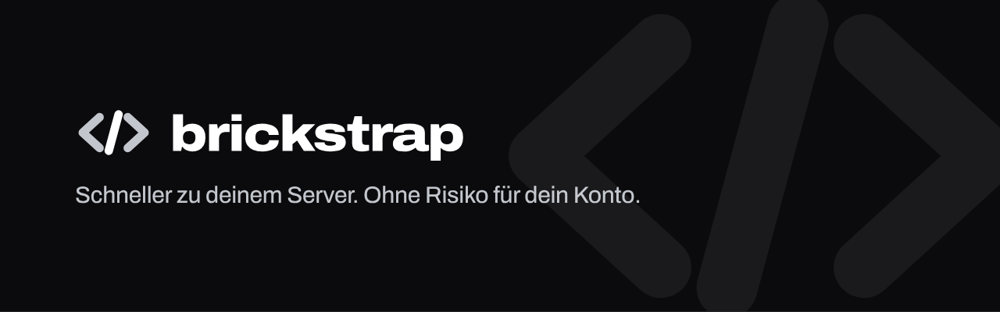
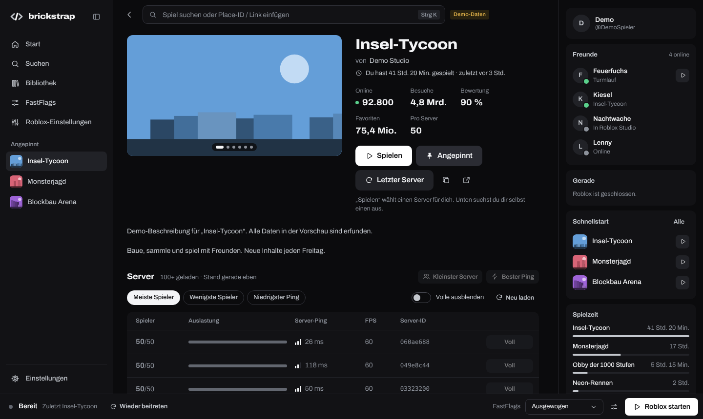
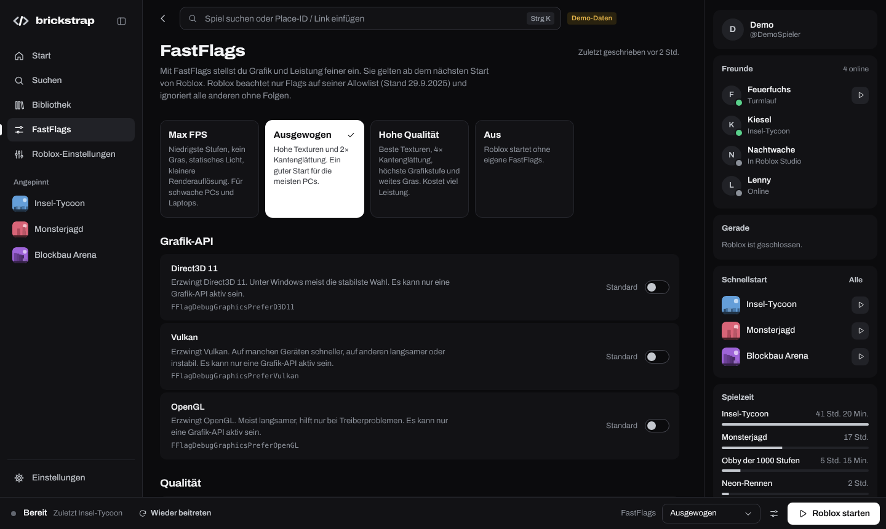

  <a href="https://github.com/Type-1-Diabetes/Brickstrap-Launcher/releases/latest"><b>Herunterladen für Windows</b></a>

Brickstrap ist ein kostenloser Launcher für Roblox. Du findest Spiele schneller, wählst deinen Server selbst und stellst Grafik und Leistung ein, ohne Roblox anzufassen.

## Warum Brickstrap

- **Dein Server, ein Klick.** Kleinster Server, bester Ping oder genau der, den du willst.
- **Freunde im Blick.** Sieh, wer online ist und was gespielt wird. Tritt direkt bei.
- **Mehr FPS.** FastFlags mit fertigen Stufen: Max FPS, Ausgewogen, Hohe Qualität.
- **Discord-Status.** Spiel, Server-Region und Spielerzahl, mit Knopf zum Beitreten.
- **Deine Spiele.** Anpinnen, Spielzeit sehen, mit „Wieder beitreten“ zurück auf den letzten Server.
- **Schnell und leicht.** Startet sofort, braucht wenig Speicher und aktualisiert sich selbst.
- **Sicher.** Brickstrap startet nur den offiziellen Roblox-Client und verändert ihn nicht. Die Anmeldung läuft über die echte Seite von Roblox.

## So geht's

1. [Neueste Version laden](https://github.com/Type-1-Diabetes/Brickstrap-Launcher/releases/latest) (`Brickstrap_…_x64.exe`).
2. Starten. Warnt Windows, klick „Weitere Informationen“ und dann „Trotzdem ausführen“.
3. Mit deinem Roblox-Konto anmelden und loslegen.

Die Bilder zeigen die Vorschau mit Demo-Daten.

---

Brickstrap ist kein Produkt von Roblox Corporation. Roblox ist eine Marke der Roblox Corporation. Mitentwickeln: siehe [CLAUDE.md](CLAUDE.md).
